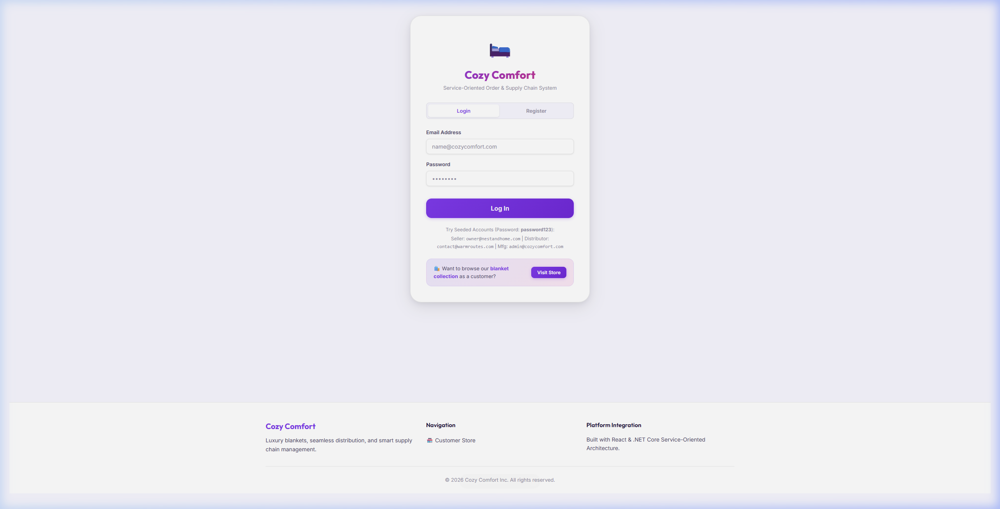
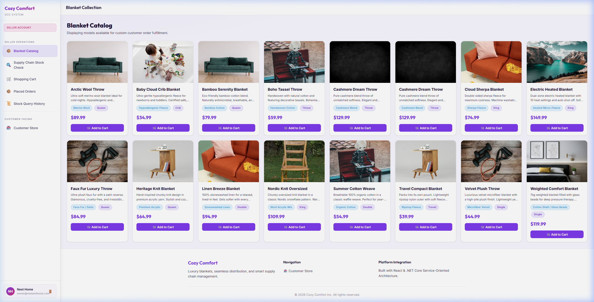
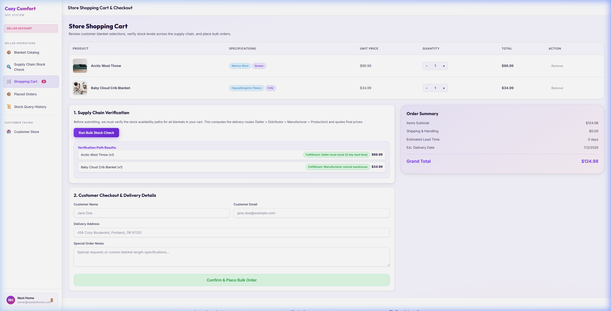
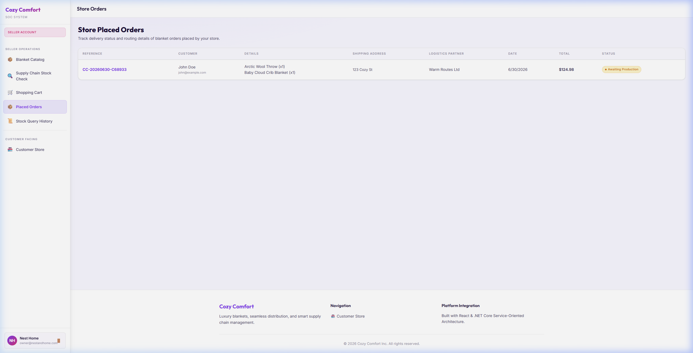
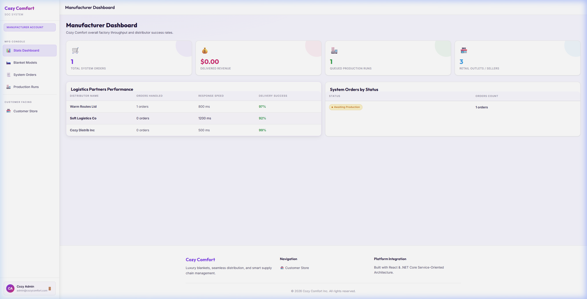

# Cozy Comfort — Supply Chain Order Management System

A full-stack blanket supply-chain management application built with ASP.NET Core (backend) and React + Vite (frontend). Models a multi-tier supply chain: **Seller → Distributor → Manufacturer → Production**.

---

## 📸 Application Tour

Here is a visual walkthrough of the Cozy Comfort system in action:

### 1. Secure Authentication
Users log in to roles such as **Seller**, **Distributor**, or **Manufacturer** to see their customized dashboards.


### 2. Storefront Blanket Catalog (Seller View)
Sellers browse available products, check specifications, and add items to their ordering queue.


### 3. Multi-Tier Supply Chain Stock Route Verification
Before checkout, the system runs a bulk supply-chain status check, querying availability downstream through all logistics tiers (**Seller → Distributor → Manufacturer → Production**).


### 4. Placed Orders & Fulfillment History
Completed orders are tracked in real-time, displaying details, delivery estimates, and fulfillment routing.


### 5. Production Queue (Manufacturer View)
When downstream inventory drops below thresholds, production runs are automatically queued at the manufacturing facility.


---

## 🔐 Login Credentials

All accounts use the same password:

| Role | Email | Password |
|------|-------|----------|
| **Seller** | `owner@nestandhome.com` | `password123` |
| **Distributor** | `contact@warmroutes.com` | `password123` |
| **Manufacturer** | `admin@cozycomfort.com` | `password123` |

> **Tip:** Log in as **Seller** to access the full storefront, catalog, shopping cart, and order placement features.

---

## 🚀 Getting Started

### Prerequisites
- [.NET 10 SDK](https://dotnet.microsoft.com/download)
- [Node.js 18+](https://nodejs.org/)

### 1. Start the Backend API

```powershell
cd CozyComfort.API
dotnet run
```

The API will start at `https://localhost:7001` (or similar). Swagger UI is available at `/swagger`.

### 2. Start the Frontend

```powershell
cd cozycomfort-web
npm install   # first time only
npm run dev
```

Open [http://localhost:5173](http://localhost:5173) in your browser.

---

## 🛒 Shopping Cart & Checkout Flow

1. Log in as **Seller** (`owner@nestandhome.com`)
2. Go to **Catalog** → click **Add to Cart** on one or more blankets
3. Open **🛒 Shopping Cart** from the sidebar
4. Click **Run Bulk Stock Check** to verify supply chain routing for all items
5. Fill in customer name, email, delivery address, and any notes
6. Click **Confirm & Place Bulk Order**

---

## 📦 Features by Role

### Seller
- Browse blanket catalog with images, sizes, and materials
- Add items to a persistent shopping cart
- Run bulk supply chain stock verification (Seller → Distributor → Manufacturer → Production)
- Checkout with customer details and place multi-item orders
- View order history and status

### Distributor
- View incoming stock requests from sellers
- Manage distributor-level stock levels

### Manufacturer
- View production orders triggered when stock is exhausted downstream
- Manage manufacturer stock and production queue

---

## 🏗️ Project Structure

```
Cozy_Comfort/
├── CozyComfort.API/          # ASP.NET Core Web API (.NET 10)
│   ├── Controllers/          # REST endpoints
│   ├── Services/             # Business logic (stock check, orders)
│   ├── Data/                 # EF Core DbContext + DatabaseSeeder
│   └── Models/               # Entities and DTOs
├── cozycomfort-web/          # React + Vite frontend
│   └── src/
│       ├── App.jsx           # Main application (state, views, handlers)
│       └── index.css         # Design system and component styles
├── Cozy_Comfort_SOA_Report.docx   # Assignment report
└── README.md
```

---

## 🗄️ Database

Uses **SQLite** (`CozyComfort.db`) via Entity Framework Core. The database is automatically created and seeded with sample blanket products and user accounts on first run.

---

## 📋 API Endpoints

| Method | Endpoint | Description |
|--------|----------|-------------|
| `POST` | `/api/auth/login` | Authenticate and receive JWT token |
| `GET` | `/api/blankets` | List all blankets in catalog |
| `POST` | `/api/stockcheck/query` | Check multi-tier stock availability |
| `POST` | `/api/orders` | Place a new order (supports multiple items) |
| `GET` | `/api/orders` | List orders for the current user |
